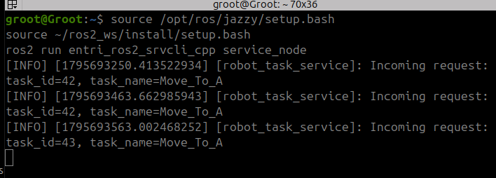
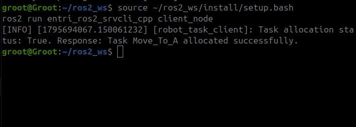

# ROS 2 Service and Client

A ROS 2 C++ project demonstrating custom service creation and communication between a service node and a client node.

## Features

- Custom service interface: `RobotTask.srv`
- Service name: `allocate_robot_task`
- Accepts even task IDs and rejects odd task IDs
- Client sends a task allocation request and receives the response


## Build

```bash
cd ~/ros2_ws
source /opt/ros/jazzy/setup.bash
colcon build --packages-select entri_ros2_srvcli_cpp
source install/setup.bash
```

## Run

Start the service:

```bash
ros2 run entri_ros2_srvcli_cpp service_node
```




In another terminal, run the client:

```bash
ros2 run entri_ros2_srvcli_cpp client_node
```


##Output

```text
Task allocation status: True. Response: Task Move_To_A allocated successfully.
```

## Testing

- Task ID `42`: Accepted
- Task ID `43`: Rejected
